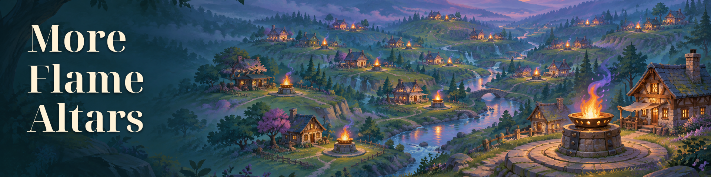

# More Flame Altars



More Flame Altars (bases) for your world, from the first Flame level on. Optionally more water sources too.

> **Which version?** This README describes 0.3.0, which needs Kiln 0.2.0-dev.28 or later. Still on Kiln 0.2.0-dev.27?
> Use **0.1.0** from [Releases](https://github.com/frostdev-ops/more-flame-altars/releases): 16 Flame Altars at every
> Flame level (see [0.1.0, for Kiln 0.2.0-dev.27](#010-for-kiln-020-dev27)).

The game ties the number of Flame Altars to the world's Flame level: a new world allows 2, and the game only reaches 16
at Flame level 11. By default this mod allows 16 at every level, so you can found all your bases from the start. Or keep
the game's progression and add a few on top.

| Flame level | 0 | 1 | 2 | 3 | 4 | 5 | 6 | 7 | 8 | 9 | 10 | 11 and up |
|---|---|---|---|---|---|---|---|---|---|---|---|---|
| Altars, the game | 1 | 2 | 4 | 6 | 8 | 10 | 11 | 12 | 13 | 14 | 15 | 16 |
| Altars, this mod (default) | 16 | 16 | 16 | 16 | 16 | 16 | 16 | 16 | 16 | 16 | 16 | 16 |
| Altars, `extraAltars: 2` with `altars: 1` | 3 | 4 | 6 | 8 | 10 | 12 | 13 | 14 | 15 | 16 | 16 | 16 |
| Water sources, the game | 1 | 1 | 1 | 1 | 5 | 10 | 20 | 30 | 40 | 50 | 50 | 50 |

(The game's numbers as read from server build 26430253.)

## Needs

Kiln 0.2.0-dev.28 or later, on the server and on every player's game: the game reads these numbers on both sides, so a
player without the mod would see and be held to the game's own numbers. Kiln's modpack hands the mod to players who
join a Kiln server.

In Kiln 0.2.0-dev.28 a player's game does not load start-up (boot) mods like this one yet: Kiln keeps them switched
off on game clients until they have passed their test in a real game (`mods.boot.client` and
`mods.boot.resource_patches`, "game test pending"). A dedicated server has them. What that means:

- **Joining a dedicated server that runs the mod:** the server refuses Kiln players whose game has not loaded the mod,
  so until those tests pass every player needs one of these two ways in:
  - the player adds `"preview": ["mods.boot.client", "mods.boot.resource_patches"]` to `kiln/kiln.json` in their game
    folder, so their game loads the mod; or
  - the server sets `"modSync": "warn"` in its `kiln/config/network.json`, so players join without the mod. Their game
    then keeps the game's own numbers: it may not let them place more altars than the game allows at the world's
    Flame level.
- **A world you host from your own game:** add the same `"preview"` line to `kiln/kiln.json` in your game folder.

`"preview"` switches on parts of Kiln that are not tested in a real game yet: use it for this, not as a habit.

## Install

- **Kiln Launcher:** Library, import `more-flame-altars-<version>.zip`, switch it on in your profile.
- **Dedicated server with Kiln:** unzip it into the server's `kiln/mods` folder and restart the server.

## Settings

`kiln/config/more-flame-altars.json` (or the mod's settings in Kiln's in-game menu). The game's table is changed once,
when the game or the server starts, so a change applies at the next start. With `beyondSixteen` on, a change to the
Flame Altar settings (`altars`, `extraAltars`, `beyondSixteen`, `mergeBases`) applies at once instead, also when you
switch `beyondSixteen` on: the mod's hook then answers the game's altar limit from the settings as they are saved, and
`mergeBases` takes effect at the game's next rebuild of its bases (the mod asks for one). Water sources always wait for
the next start.

| Setting | Default | What it does |
|---|---|---|
| `altars` | 16 | At least this many Flame Altars at every Flame level (1 to 16; up to 128 with `beyondSixteen`). |
| `extraAltars` | 0 | Added to the game's own number at every level, up to 16 (127 with `beyondSixteen`). |
| `waterSources` | 0 | At least this many water sources at every level (0 to 50; 0 leaves the game's numbers). |
| `extraWaterSources` | 0 | Added to the game's own number of water sources at every level, up to 50. |
| `beyondSixteen` | false | **Experimental, may crash your game.** Allows more than 16 Flame Altars, up to 128. See below. |
| `mergeBases` | true | **Experimental**, only with `beyondSixteen`. With more than 16 altar zones in the world, all altars become one base, so altars past 16 are real base area. Off: altars past 16 are build-only. See below. |

A level never gets less than the game gives it. With every setting at its lowest the mod changes nothing.

## More than 16 altars (experimental)

**This can crash your game. If you want to try anyway, it is your world and your call:** the mod lets you go up to 128
and does not stop you below that. Back up your save first. Every player needs the mod (a Kiln client follows the
server's limit and merge when it joins and when they change; a game without the mod stops at 16). It is off by default
and only for admins to switch on.

The game is built for 16 bases. Its own code allows at most 16 Flame Altars whatever its table says, and the part of the
game that runs bases (comfort, crafting from base chests, beds and homes for survivors, animals, the journal's base
list) keeps 16 zones and 16 bases. With `beyondSixteen` on, the mod lifts the first limit through Kiln's hooks, up to
128. What happens past 16 depends on `mergeBases`:

- **`mergeBases` on (the default with `beyondSixteen`):** once the world has more than 16 altar zones, the mod gives the
  game's base system room for all of them and makes **all altars one base**. Every altar is then base area: comfort,
  crafting from base chests, survivor beds, animals and the rest work at all of them. The price: the journal lists one
  base, every base chest is shared by all altars, and comfort, beds and the rest are one base's. With 16 zones or fewer
  the game's own separate bases stay. The technique is XHL's (see Credits); the code is the mod's own.
- **`mergeBases` off:** the game's 16 bases stay. Altars 17 and up let you build, but they are not bases: no comfort, no
  crafting from base chests, no survivor beds, no animals, no journal entry; which altars those are follows the order
  the game lists them in, which can change after a reload.

Known risks, plainly:

- Nobody has tested more than 16 altars with this mod in a real game yet (see What is checked). The merge changes the
  game's base system in memory on the server and on every player's game; a mistake there can crash the game.
- Other mods' "unlimited altars" switches are reported to crash the game past about 36 altars. The cause was never
  pinned down. Static reading found no overflow in the game's zone code up to 255 zones, and the parts that iterate
  altar entities (spawn points, map markers, fast travel) were not checked.
- The game's zone list sent to players is a single network message; past about 43 zones the server logs that it is
  big, and past the session's message limit (unknown) a player may miss zone updates.
- A player's game draws at most 32 zone borders at once; past 32 in view some borders are not drawn.
- With `mergeBases`, the zone list has room for every zone, and the game's own base rebuild then tries to make a base
  record for each separate zone past 16, which has no room and would overwrite the zone list. The mod skips those
  records; that check is tested on a lab server, the rest of a merged world is not.

Altars that touch or overlap count as one base in the game already ("extension altars").

50 water sources is the most the game's own table gives, so the mod stays at or below it.

## /altars

Type `/altars` in the chat. With the mod in your game, a window opens: the world's Flame level, the altars and water
sources placed and allowed, the numbers at every Flame level, and the mod's settings. Admins (permission
`more-flame-altars.manage`) can change the settings there (see [Settings](#settings) for when they apply: the altars
at once with `beyondSixteen` on, otherwise at the next start of the server, or of your game when you host) and set the
world's Flame level. The window also has the `beyondSixteen` and `mergeBases` switches, with their warnings. Everyone else sees the same window, read only.

Admin commands, also from the server console: `/altars set <altars|extraAltars|waterSources|extraWaterSources|beyondSixteen|mergeBases> <value>`
(use 0 or 1 for `beyondSixteen` and `mergeBases`) and `/altars flame <level>`. They use the same `more-flame-altars.manage` permission
as the window. From the console, `/altars` prints a one-line summary.

## How it works

The numbers are lists in the game's balancing table (`keen::BalancingTable`: `altarsPerFlameLevel` and
`waterSourcesPerFlameLevel`, one number per Flame level). The game reads that table once, at its start, so the mod
changes it in Kiln's boot phase (`Mod.OnBoot`, a resource patch), before the game reads it. The limit patch does not
rewrite the game's files or your save: remove the mod and the next start has the game's numbers again. Changing the
world's Flame level through `/altars` does change world progress and is saved by the game.

## What is checked

0.3.0, on a lab server (Kiln 0.2.0-dev.28 as released, runtime 0.2.0-dev.28+20261114.2301cc5, server build 26430253, no
player), by the lab test in `tests/LabTest`, with four settings: `altars: 128` with `beyondSixteen` and `mergeBases`;
the defaults with `beyondSixteen` off; `altars: 24` with `beyondSixteen` and `mergeBases` off; `altars: 1`,
`extraAltars: 2` with both on:

- the running game's table holds exactly the expected numbers at all 21 Flame levels (128 at every level with
  `altars: 128`), and Kiln's `WorldProgress.LimitsAt` reports them; settings that change nothing stage nothing;
- the game's own altar-limit function, called with a made-up table, answers what the settings say through the mod's
  hook: 128 at every Flame level with `altars: 128`, and the game's min(value, 16) with `beyondSixteen` off;
- `mergeBases`: the game's own base rebuild, run on the server's real base system with a made-up world of separate
  altar zones: with 20 zones, the game tries to make 20 base records and the mod skips the 4 past 16; with 20 and with 40
  zones every zone is in the base system's list and they are one base; the game's own queries put a point in the 40th
  zone in base 0 and a point between zones in no base; with the merge off, the same world gives the game's 16 zones and
  16 bases, and the 40th zone is in no base.

Offline (`tests/Offline`): the settings accept and save 128 and refuse 129, and the message that tells players the
server's limits carries the server's merge switch. Statically, for the client exe (build 26430625): every function the mod hooks has the same bytes as on the
server, and the patterns match exactly once in both exes.

0.2.0 was checked in a real game (a world hosted from the game, Kiln 0.2.0-dev.28 test build, with the `"preview"`
line above): placing more Flame Altars than the game's number for the world's Flame level, past 16 with `beyondSixteen`
too (then capped at 32), and the `/altars` window.

**Not checked yet:**

- anything of 0.3.0 in a player's game: the client side of the merge (a player's base system and base UI lists), the
  raised limit past 32, and a client following the server's merge when it joins;
- placing more than 16 altars in a real game with 0.3.0, with `mergeBases` on or off, and past 32 or 36 altars: whether
  the merged base's comfort, base chests, survivors and the journal behave, and whether the game crashes;
- placing more water sources than the game's number; a joining player with and without the mod; removing the mod from
  a world that has more altars than the game's number allows (the altars should stay, and no new one can be placed
  until the Flame level allows it).

## Changes

- **0.3.0** (Kiln 0.2.0-dev.28): up to 128 Flame Altars with `beyondSixteen` (was 32). New `mergeBases` (on by default
  when `beyondSixteen` is on): past 16 altar zones all altars become one base, so altars past 16 are real base area
  (XHL's technique, our code). The mod also stops the game's base rebuild from writing a 17th base record over its zone
  list. The window and `/altars set` have the new switch; the risks are stated in the window, here and on the mod page.
  Players need 0.3.0 too (the window's channel is version 3): a 0.2.0 game and a 0.3.0 server do not talk.
- **0.2.0** (Kiln 0.2.0-dev.28): the C# version: settings, water sources, `/altars` window and commands, the
  experimental `beyondSixteen` (up to 32, build-only past 16).
- **0.1.0** (Kiln 0.2.0-dev.27): the start-up data version in `eml/`, 16 altars at every level.

## 0.1.0, for Kiln 0.2.0-dev.27

`eml/` holds the first version, released as 0.1.0: a start-up data mod (`mod.json` + `src/mod.lua`) that Kiln runs
before the game starts. It does one thing: at least 16 Flame Altars at every Flame level. No settings file, no
`/altars`, no water sources; the number is `ALTARS` at the top of `src/mod.lua` (1 to 16). Like 0.2.0, it goes on the
server and in every player's game. Do not use 0.1.0 and 0.2.0 at once: 0.2.0 replaces it.

- **Kiln Launcher:** Library, import `more-flame-altars-0.1.0.zip`, switch it on in your profile.
- **Dedicated server with Kiln:** unzip it into the server's `kiln/eml/mods/more-flame-altars/` (so that
  `kiln/eml/mods/more-flame-altars/mod.json` exists) and restart the server.

Checked on a lab server with Kiln 0.2.0-dev.27 (the running game's table had 16 at every level); placing the altars in
a player's game is not checked yet.

To make its zip: `mkdir -p dist && (cd eml && zip -r ../dist/more-flame-altars-0.1.0.zip mod.json src)`.

## Development

```sh
ln -s ~/Kiln-release/kiln-0.2.0-dev.28/sdk kiln-sdk        # the SDK
dotnet build -c Release -t:KilnPack -p:KilnPackageOutputPath=dist/
# managed regression checks; no game server needed
dotnet run --project tests/Offline -c Release
# lab check (a lab made with Kiln's tools/lab/lab.sh, Kiln 0.2.0-dev.28 in it)
lab=/path/to/lab
dotnet build -c Release -t:KilnDeploy -p:KilnServer="$lab"
(cd tests/LabTest && dotnet build -c Release -t:KilnDeploy -p:KilnServer="$lab")
kiln run --server "$lab" --wait 300 && kiln test more-flame-altars-labtest --server "$lab" && kiln run --server "$lab" --stop
```

`art/` holds the banners and thumbnails (`art/compose.py` rebuilds them from `art/source/`, made with an image
generator; `art/source/generation_prompts.json` has the prompts).

## Credits

`mergeBases` uses the technique of XHL's "XHL-Unlimited-Flame-Altars" 2.1.0 (MIT): a larger zone list for the game's
base system, all zones as one base, and the game's base queries answered from the zone list. We read XHL's mod
statically to learn it; More Flame Altars ships none of its code. Thank you, XHL.

## License

MIT, see [LICENSE](LICENSE). Unofficial, and not affiliated with or endorsed by Keen Games.
